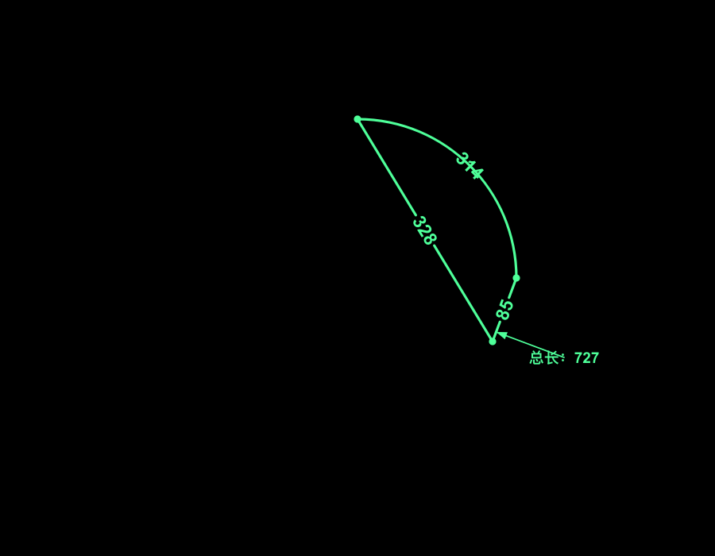

# 速看CAD 2.0.2

本地只读查看 DWG、DXF、PDF，提供施工图测量、矢量标注和多页打印。



## 下载

- macOS 12+，Intel 与 Apple Silicon：
  [PKG](https://github.com/heykite2016/Sukancad/releases/download/v2.0.2/CadLens-2.0.2-macos12-universal.pkg)
  · [DMG](https://github.com/heykite2016/Sukancad/releases/download/v2.0.2/CadLens-2.0.2-macos12-universal.dmg)
- Windows 10+ x64：
  [免安装 ZIP](https://github.com/heykite2016/Sukancad/releases/download/v2.0.2/CadLens-2.0.2-windows10-x64-portable.zip)
- Android arm64 核心移植版：
  [APK](https://github.com/heykite2016/Sukancad/releases/download/v2.0.2/CadLens-2.0.2-android-arm64.apk)
  · [移植范围](ANDROID.md)
- [SHA-256 与全部发布文件](https://github.com/heykite2016/Sukancad/releases/tag/v2.0.2)
- Gitee：[源码](https://gitee.com/FanieWang/Sukancad) · [发布页](https://gitee.com/FanieWang/Sukancad/releases/tag/v2.0.2)

macOS 为 ad-hoc 签名，未做 Developer ID 公证。Windows 包未使用商业代码签名证书。

## 当前功能

- 读取 DWG、DXF 和多页 PDF；DWG/DXF 支持模型空间与布局空间。
- 图层显隐、布局视口、外部参照定位、对象捕捉、栅格、正交和窗口缩放。
- 读取 ACI/RGB 颜色、线宽、文字、块属性、HATCH 边界与图案；图案填充使用有界预算绘制。
- 测量：对齐、线性、连续、批量、矩形、多边形、圆面积、填充面积、侧面积、半径、角度、弧长。
- 标注：实时预览、文字注释、比例校准、拖动、备注、显隐、撤销、重做、整体删除与批量删除。
- 尺寸样式：中国室内常用、大号建筑斜线、机械 ISO-25、工程开口箭头、小数圆点、紧凑端线。
- 输出：SVG、600/1200/2400 DPI 打印、多页打印、打印到 PDF、布局图框批量打印。
- 命令行只接受英文 ASCII 命令；测量与标注自动保存到本机。
- 原始图纸始终只读，不会写回 DWG、DXF 或 PDF。
- Android 端已移植 DWG/DXF 解析、布局、图层、外部参照、测量核心与文字标注；
  测量点使用可拖动的浮动虚拟鼠标定位；点击尺寸线、尺寸文字或标注子图元可直接编辑，
  白色方框拖动后实时重算，删除、完成和取消集中在动作条；PDF 尚未移植。

## 快速开始

1. 打开 DWG、DXF 或 PDF。
2. 使用底部标签切换模型、布局或 PDF 页面。
3. 点击主工具栏“测量工具”，选择测量类型；面板可悬浮或停靠左右。
4. 点击主工具栏“设置”调整标注样式、单位、精度、颜色和十字光标。
5. `Ctrl+S` 保存标注；关闭图纸后再次打开会自动恢复。

常用快捷键：

| 操作 | 快捷键 |
| --- | --- |
| 选择、删除、对齐、线性 | `V`、`E`、`A`、`L` |
| 连续、批量、多边形 | `C`、`B`、`P` |
| 矩形、圆面积、填充面积、半径 | `Shift+R`、`O`、`F`、`R` |
| 角度、弧长、侧面积、比例校准 | `G`、`K`、`Shift+S`、`Shift+C` |
| 文字注释、窗口缩放、显示全图 | `T`、`Z`、`0` |
| 对象捕捉、栅格、正交 | `F3`、`F7`、`F8` |
| 命令行、打印预览 | `Ctrl+9`、`Ctrl+P` |

完整操作和命令别名见 [USAGE.md](USAGE.md)。

## 数据位置

- 正式标注：用户应用数据目录下的 `annotations/`。
- 自动恢复、解析缓存和最近记录：系统缓存目录。
- 最近图纸默认保留 12 条；解析缓存和未保存自动副本保留 30 天。

具体路径与清理规则见 [DATA_STORAGE.md](DATA_STORAGE.md)。

## 构建

已验证：macOS 12+、Qt 6.8.3、CMake 3.28+、Ninja、Apple Clang；Windows x64 由 llvm-mingw Clang 17 交叉编译。

```bash
export QT_ROOT="$HOME/Library/Caches/CadLens/Qt/6.8.3/macos"
export CADLENS_MAC_PDFIUM_ROOT="$HOME/Library/Caches/CadLens/pdfium/chromium-8125-mac-univ"

./script/build_and_run.sh
ctest --test-dir build --output-on-failure
```

完整依赖与发布步骤见 [BUILDING.md](BUILDING.md) 和 [RELEASE.md](RELEASE.md)。

## 文档与许可

- [使用说明](USAGE.md)
- [数据与缓存](DATA_STORAGE.md)
- [构建](BUILDING.md)
- [Android 移植](ANDROID.md)
- [发布](RELEASE.md)
- [版本记录](CHANGELOG.md)
- [参与贡献](CONTRIBUTING.md)
- [社区行为准则](CODE_OF_CONDUCT.md)
- [安全策略](SECURITY.md)
- [版权与第三方许可](NOTICE.md)

项目按 GPL-3.0-or-later 发布，见 [LICENSE](LICENSE)。
